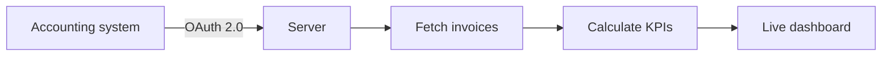

# 📊 Financial Dashboard – Overview

> ⚠️ **Overview only.** The real project is private because it contains confidential information. This repository contains no source code or real data.

## Why
Give the finance team a real-time view of invoices and revenue, without manual exports from the accounting system.

## Workflow

## Tech
JavaScript · Node.js · OAuth 2.0 · REST API

---

### 🤖 How it was built

I designed the idea, defined the requirements and parameters, and tested the project until it worked correctly. AI (Claude) helped me with the coding.
